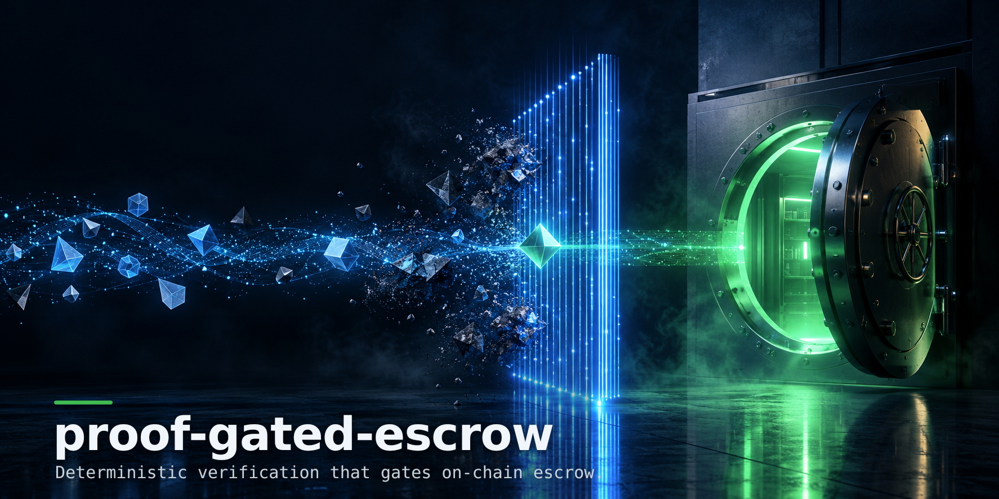

# Proof-Gated Escrow

Deterministic job-result verification for an escrow marketplace. A customer funds
a job in a Solidity escrow; a provider submits work; a **pure Rust verifier**
decides whether the submission meets the job's acceptance criteria and emits a
`commitment` hash; the escrow releases funds against that commitment. A small
Node.js backend ties the three together.

This repository is a working reference implementation of that pipeline, built
around the three concerns that make such a system trustworthy: **determinism**,
**canonical hashing**, and **explicit, typed failure**.

```
customer ──fund()──►  Escrow.sol  ◄──releaseWithVerification(jobId, commitment)── verifier key
                          ▲                                   ▲
                          │                                   │
provider ──submission──►  Node.js backend  ──spec+submission──►  Rust verifier (pure)
                                           ◄──────verdict────────   → commitment hash
```

## Why it is built this way

- **The Rust verifier has no side effects.** It never reads files or the
  network. A submission carries its artifact hashes and a `metadata` object; the
  verifier only checks those values against the spec's criteria. Identical inputs
  therefore produce an identical verdict — and an identical `commitment` — on any
  machine, which is what lets the escrow trust the result.
- **Hashing is canonical.** Spec and submission are canonicalized (object keys
  sorted recursively, compact serialization) before hashing, so two logically
  equal inputs that differ only in key order commit to the same hash. The
  commitment is `sha256(canonical(spec) ++ 0x1f ++ canonical(submission))`.
- **Failures are typed.** A criterion that is simply not met is a *failed check*
  inside a successful verdict. A structurally broken input (missing field, bad
  hash, job-id mismatch) is a distinct `VerifyError`, so the backend maps it to a
  stable HTTP status instead of scraping text.

## Layout

```
rust-verifier/     Pure verification library + CLI (the core of the system)
  src/lib.rs         public API: verify(spec, submission) -> Verdict
  src/spec.rs        JobSpec, Criterion, Submission, Verdict types
  src/hashing.rs     canonicalization + SHA-256 commitment
  src/verification.rs validation + criterion evaluation
  src/error.rs       typed error surface
  src/bin/verifier_cli.rs  stdin/path CLI the backend calls
  tests/             13 behavioural tests
contracts/         Solidity escrow + Hardhat test suite
  contracts/Escrow.sol
  test/escrow.test.js
backend/           Node.js API wiring the verifier to the escrow
  src/verifier.js    spawns the Rust CLI
  src/chain.js       escrow settlement  ⚠️ see "Known limitations"
  src/index.js       Express API
docs/fixtures/     sample spec + pass/fail submissions
```

## Acceptance criteria supported

| kind              | checks                                                        |
|-------------------|--------------------------------------------------------------|
| `artifact_sha256` | a submitted artifact at `path` has exactly `expected` hash   |
| `field_equals`    | value at a JSON pointer equals `expected`                    |
| `numeric_at_least`| numeric value at pointer is `>= min`                         |
| `numeric_at_most` | numeric value at pointer is `<= max`                         |
| `string_contains` | string at pointer contains `needle`                          |

## Running it

### Rust verifier (core)

```bash
cd rust-verifier
cargo test                      # 13 tests
cargo build --release
./target/release/verifier-cli ../docs/fixtures/spec.json ../docs/fixtures/submission_pass.json
# exit 0 + Verdict JSON on pass, exit 2 on fail, exit 3 on structural error
```

### Solidity escrow

```bash
cd contracts
npm install
npx hardhat test
```

### Backend

```bash
cd backend
npm install
VERIFIER_BIN=../rust-verifier/target/release/verifier-cli npm start
# POST /verify            -> { verdict }
# POST /verify-and-settle -> { verdict, settlement }
```

## Status of each part in this repo

| Component            | State in this repo                                              |
|---------------------|-----------------------------------------------------------------|
| Rust verifier + CLI | Complete. `cargo test` passes (13/13), verified in CI-style run. |
| Solidity escrow     | Complete. Compiles clean under solc 0.8.24 (0 errors/warnings). Hardhat suite written (9 tests). |
| Backend API         | Complete for `/verify`; `/verify-and-settle` works end-to-end against the real Rust binary. |
| On-chain settlement | **Intentionally stubbed — see below.**                          |

## Known limitations

### On-chain settlement is simulated, not broadcast (intentional)

`backend/src/chain.js :: settleOnChain()` is the one component left deliberately
incomplete. It validates the commitment, derives the on-chain `jobId`
(`keccak256` of the off-chain id) exactly as `Escrow.sol` expects, and returns a
receipt — but with `simulated: true` and a synthetic `txHash`. It does **not**:

- load the verifier's private key or connect a signer to an RPC endpoint,
- call `Escrow.releaseWithVerification(jobId, commitment)` on-chain,
- wait for a real transaction receipt.

The production path is written out, commented, directly above the stub using
ethers v6. It is left unwired on purpose so the escrow's trusted key is never
loaded in a demo, and so the first integration task is explicit rather than
hidden. Wiring it is item 1 of the roadmap.

**Why this is the honest place to stop:** everything up to the settlement call is
deterministic and fully testable without funds or a live chain. The settlement
call is the only step that needs a funded key and a deployed contract address,
so it is the one part that cannot be meaningfully exercised in a self-contained
demo. The response shape already surfaces `simulated: true` so no caller can
mistake a demo settlement for a real one.

## Roadmap

1. Wire `settleOnChain` to a live signer + deployed escrow (replace the stub).
2. Replace trusted-key release with a signed attestation the contract verifies
   on-chain (EIP-712), removing the need for the verifier to hold a hot key.
3. Deploy `Escrow.sol` to Sepolia and add an end-to-end integration test that
   funds, verifies, releases, and asserts the stored commitment.
4. Evaluate a Solana/Anchor verifier program for cross-chain settlement.

## Notes on the environment this was developed in

The Rust tests were executed and pass. The Solidity contract was compiled with
solc 0.8.24 (standalone) to confirm it builds with zero errors and zero
warnings; the Hardhat test suite is written and runs on any machine where
Hardhat can fetch the compiler (the development sandbox blocked the compiler
download host, so the Hardhat run itself was not executed here).

## License

MIT.
